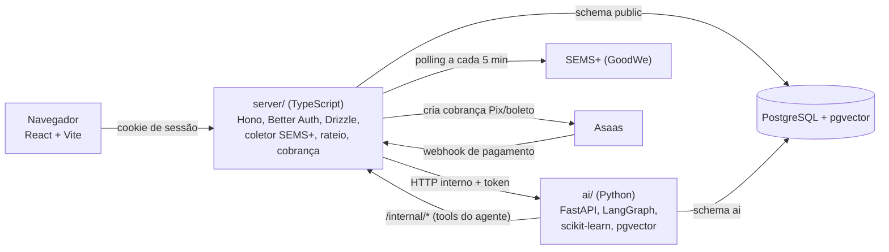
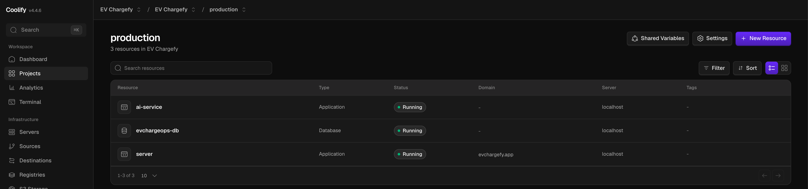
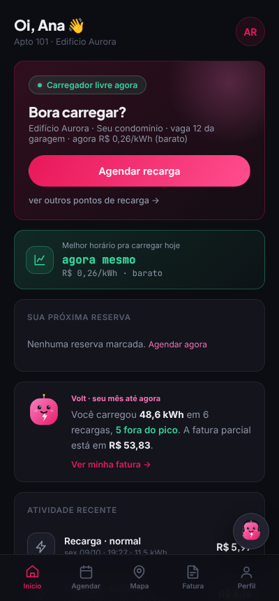
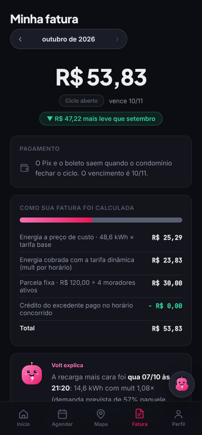
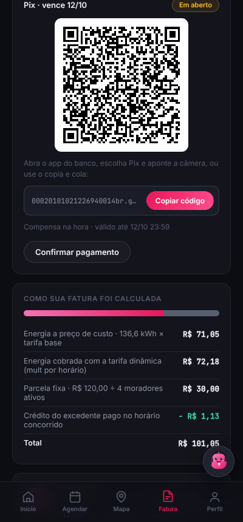
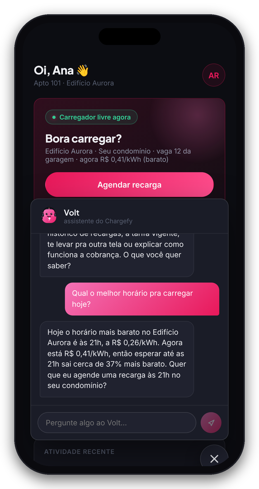
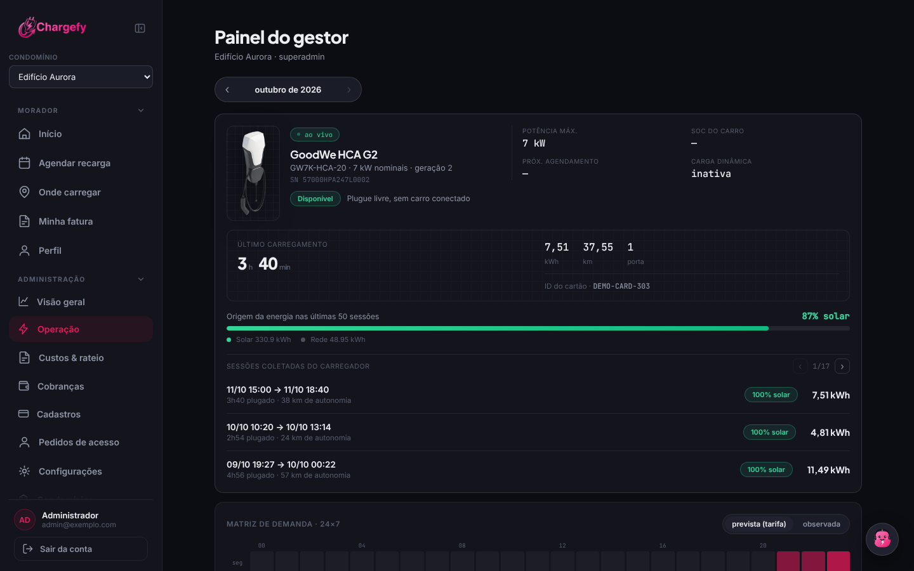
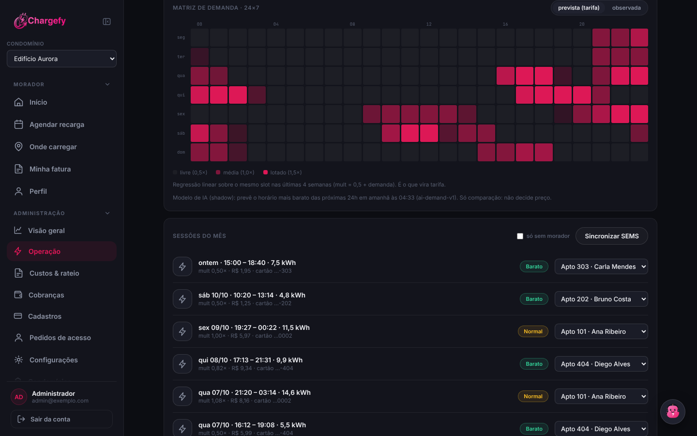
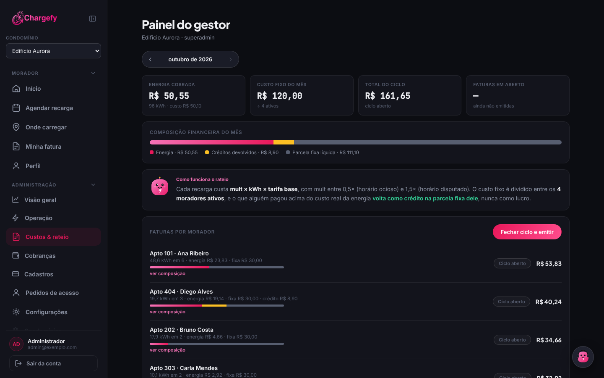
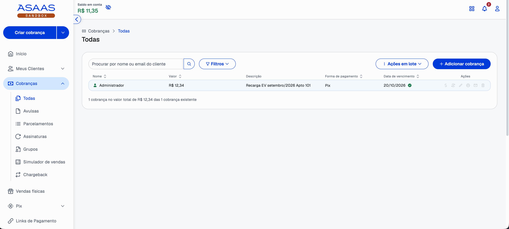

# EV ChargeOps (Chargefy) - Enterprise Challenge 2026


### GoodWe + FIAP · Sprint 2 · Protótipo funcional

---


Protótipo funcional da plataforma de recarga compartilhada definida na
[Sprint 1](https://github.com/Aurora-Siger/EV-ChargeOps-S1).

O sistema lê o carregador GoodWe HCA G2 do estacionamento L1 da FIAP Aclimação pela SEMS+,
transforma cada recarga em uma sessão com dono (pelo cartão RFID), calcula o preço com a
tarifa dinâmica, fecha o rateio do mês e emite a cobrança por Pix ou boleto. A IA define o
multiplicador de preço de cada sessão e atende o morador e o gestor por um assistente, o Volt
(o e-Síndico da Sprint 1).

Em produção em [evchargefy.app](https://evchargefy.app), hospedado em uma VPS com Coolify.

**Vídeo:** [Demonstração do fluxo de agendamento pelo Volt e da geração de fatura](https://youtu.be/vjOGHfS68JY)

## Sumário

- [Equipe](#equipe)
- [O que foi implementado](#o-que-foi-implementado)
- [Arquitetura](#arquitetura)
- [Da recarga à fatura](#da-recarga-à-fatura)
- [O módulo de IA](#o-módulo-de-ia)
- [Evidências de funcionamento](#evidências-de-funcionamento)
- [Como executar](#como-executar)
- [Estrutura do repositório](#estrutura-do-repositório)
- [Decisões técnicas](#decisões-técnicas)
- [Desvios em relação à Sprint 1](#desvios-em-relação-à-sprint-1)

## Equipe

| Nome | RM |
|---|---|
| Isabelle Caroline de Camargo Francisco | 572096 |
| Matheus Lyncoln Souza Dias | 570765 |
| Mirela Aparecida Bispo Miguel | 570830 |
| Rodrigo Abrantes Mizerani | 571808 |

## O que foi implementado

**Para o morador:** tela inicial com o estado do carregador e o melhor horário do dia,
agendamento de recarga por meta de bateria e prazo ou por horário de início, mapa de pontos de
recarga, fatura do mês com a composição do valor, pagamento por Pix ou boleto e o Volt para
tirar dúvidas.

**Para o gestor (síndico):** telemetria do carregador ao vivo, lista de sessões com dono e
preço, matriz de demanda 24×7, rateio do mês com lançamentos (despesas extras e ajustes por
morador) e fechamento do ciclo, cobranças, cadastro de
moradores, unidades, veículos e cartões RFID, pedidos de acesso de convidados e configuração
dos parâmetros do condomínio (custo fixo, valor do minuto ocioso, carência, vencimento).

**Para a rede:** vários condomínios (workspaces) na mesma instalação, com superadmin, síndico,
morador e convidado.

## Arquitetura



| Parte | Tecnologia | Responsabilidade |
|---|---|---|
| `src/` | React 19, Vite, TypeScript | app do morador, painel do gestor e landing |
| `server/` | Node, Hono, Better Auth, Drizzle, Playwright | autenticação, API, coletor SEMS+, sessões, rateio, faturas, cobrança, reservas |
| `ai/` | Python, FastAPI, LangChain/LangGraph, scikit-learn | agente Volt, base de conhecimento (RAG), modelo de demanda |
| Banco | PostgreSQL 16+ com pgvector | dados do negócio no schema `public`, conversas e embeddings no schema `ai` |

O `server` é dono das regras de negócio e da segurança. O `ai` nunca é exposto ao navegador e
não lê as tabelas de negócio: quando o agente precisa de um dado, chama uma rota `/internal/*`
do `server`, que aplica as mesmas regras de autorização da API. Detalhes em
[docs/ARCHITECTURE.md](docs/ARCHITECTURE.md).

## Da recarga à fatura

Esta é a lógica central pedida no desafio. Cada passo aponta para o código que o executa.

**1. Coleta.** O coletor (`server/src/modules/sems/sems.collector.ts`) faz login na SEMS+ com
um navegador headless, captura os headers `token` e `X-Signature` que o próprio portal gera
(`server/src/infra/sems/login.ts`) e, a cada 5 minutos, grava o status do carregador
(`ev-charger/detail`), o histórico de sessões (`queryChargeLogList`) e a série de potência
(`timeSeriesData`) no Postgres. Quando o token expira, ele faz login de novo sozinho.

**2. Sessão com dono.** Depois de cada coleta, `sessionsService.syncFromSems`
(`server/src/modules/sessions/sessions.service.ts`) transforma o log bruto em sessões, de forma
idempotente pelo número de série da recarga. O dono vem do cartão RFID cadastrado; sessão sem
cartão conhecido fica para o gestor atribuir, e uma atribuição manual nunca é sobrescrita.
A tarifa base vigente é congelada na sessão quando ela entra.

**3. Ociosidade.** A SEMS não informa quando o cabo foi retirado, mas o status coletado sim:
o campo `vehConnStu` vale 0 com o cabo fora, 1 com o carro plugado sem carregar e 2 carregando. `server/src/modules/sessions/domain/idle.ts`
mede do fim da carga até o último status ainda plugado, com a precisão do intervalo de coleta,
limitado à próxima sessão e a 12 horas.

**4. Preço da sessão.** `server/src/modules/billing/domain/demand.ts` prevê a demanda do horário
e `rateio.ts` aplica o modelo da Sprint 1:

```
demanda         = regressão linear da ocupação do mesmo slot (hora × dia da semana)
                  nas 4 semanas anteriores
mult            = 0,5 + demanda                        (piso 0,5×, teto 1,5×)
ocioso_cobrável = max(0, minutos_ociosos − 15)
custo_sessão    = mult × (kWh × tarifa_base + ocioso_cobrável × valor_minuto)
```

**5. Rateio do mês.** O custo fixo do carregador é dividido igualmente entre os moradores que
carregaram no ciclo; quem não carregou fica isento. O que cada um pagou acima do custo real da
energia (o efeito do multiplicador) volta como crédito na sua parcela fixa, limitado ao valor
dela, para que a tarifa dinâmica redistribua o custo e não gere lucro. Convidados pagam só o
consumo, e o excedente deles abate o custo fixo antes da divisão.

```
parcela_fixa = (custo_fixo + despesas do mês − excedente dos convidados) ÷ moradores ativos
crédito      = min(parcela_fixa, max(0, cobrado − custo real da energia))
fatura       = max(0, energia cobrada + parcela_fixa − crédito + ajustes da pessoa)
```

O gestor pode lançar no ciclo despesas extras do mês (uma manutenção, um reparo), que somam ao
custo fixo e são rateadas do mesmo jeito, e ajustes para uma pessoa (crédito ou débito), que
entram só na fatura dela. Cada lançamento aparece com a descrição na fatura de quem paga. Num
ciclo já fechado, as faturas são refeitas na hora; com fatura paga, os lançamentos travam.

**6. Fatura e cobrança.** Depois que o mês termina, o gestor fecha o ciclo
(`server/src/modules/billing/billing.service.ts`), que grava as faturas numa transação. A partir
daí as sessões daquele mês ficam congeladas: mudar a configuração do condomínio não altera
fatura emitida. O morador gera Pix ou boleto na tela da fatura. Com
`ASAAS_API_KEY` configurada, a cobrança é criada no Asaas e a baixa chega pelo webhook
(`server/src/modules/charges/webhooks.routes.ts`), que confere o token, ignora eventos
repetidos e confere o valor recebido. Sem a chave, um gateway simulado gera códigos em formato
válido e um botão confirma o pagamento, o que permite rodar a demonstração sem conta no Asaas. O Asaas exige CPF/CNPJ do pagador: o
morador informa no Perfil (ou o gestor, no cadastro dele), e a emissão em lote pula quem ainda
não informou e avisa o gestor.

As regras de preço, rateio, ociosidade e agendamento são funções puras, separadas do banco e
cobertas por testes (`server/src/modules/*/domain/*.test.ts`).

## O módulo de IA

A Sprint 1 definiu três abordagens de IA a partir do mesmo modelo de demanda. As três estão no
caminho principal do sistema:

| Sprint 1 | Sprint 2 |
|---|---|
| Abordagem 1: previsão de demanda por regressão linear → multiplicador dinâmico | Regressão por slot que define o `mult` de cada sessão (item 1), com um modelo de árvores em shadow ao lado (item 2) |
| Abordagem 2: recomendação de horário com economia estimada | Card "melhor horário" e agendamento que escolhe a janela mais barata até o prazo do morador, a partir da mesma curva |
| Abordagem 3: e-Síndico, linguagem natural sobre os dados calculados | Volt, o assistente (item 3) |

### 1. Previsão de demanda que define o preço

É o modelo da Sprint 1: regressão linear por slot de hora e dia da semana sobre a ocupação real
do carregador. O resultado é o `mult` de cada sessão, ou seja, ele decide quanto cada recarga
custa. A mesma curva hora a hora alimenta o card "melhor horário" da tela inicial, a escolha da
janela no agendamento e as respostas do Volt sobre preço, então o valor mostrado em qualquer
lugar é o mesmo que vai para a fatura (`GET /api/pricing/curve`).

Ficou em TypeScript, dentro do `server`, porque é uma regressão de uma variável que precisa
rodar a cada sincronização para todas as sessões, e mantê-la junto do rateio deixa o cálculo da
fatura auditável num lugar só.

### 2. Modelo de demanda em shadow

`ai/training/train.py` treina um `GradientBoostingRegressor` (scikit-learn) com a telemetria
gravada pelo coletor, usando hora e dia da semana codificados em seno e cosseno. O modelo só é
salvo se tiver erro menor que um baseline ingênuo (a média) no conjunto de teste, e o motor
(`ai/app/pricing/engine.py`) o carrega em modo shadow: a previsão aparece no painel do gestor
ao lado da regressão, mas não cobra nada.

O motivo de ele não substituir a regressão vem dos dados de produção. Entre 29/07 e 12/10/2026
o carregador da FIAP Aclimação registrou 89 recargas reais, todas sem cartão individual (a SEMS
grava o serial do próprio carregador no lugar do cartão), então na prática é um usuário só. As
recargas de demonstração que o seed grava no mesmo banco ficaram de fora. O uso se concentra à
noite: 65% das recargas começam entre 20h e 21h59, e a ocupação média passa de 60% entre 21h e
23h, contra menos de 3% das 4h às 17h. O volume também mudou: foram 17 recargas na semana de
07/09 e de 5 a 7 nas últimas semanas.

Para comparar os dois do jeito que a fatura usa, simulamos as 7 semanas completas que já
tinham 4 semanas de histórico antes delas (de 24/08 a 11/10). Em cada semana, cada método
previu a ocupação de cada hora usando só os dados anteriores, e o modelo foi treinado com a
mesma ocupação que a regressão usa:

| Previsão da ocupação por hora | Erro médio (MAE, de 0 a 1) |
|---|---|
| Regressão do S1 (mesmo slot, 4 semanas) | 0,133 |
| Média do mesmo slot nas 4 semanas | 0,142 |
| GradientBoosting com todo o histórico | 0,145 |
| GradientBoosting só com as últimas 4 semanas | 0,147 |
| Média de cada hora, sem o dia da semana | 0,147 |
| Média geral | 0,252 |

A regressão teve o menor erro médio e venceu em 4 das 7 semanas, com folga maior nas semanas
em que ganhou (de 0,024 a 0,038) do que o modelo nas que ele ganhou (de 0,008 a 0,014). O
modelo de árvores ficou praticamente igual à média por hora: com um usuário só, o dia da semana
não tem um perfil que se repita de uma semana para a outra. Quando o uso caiu no fim de
setembro, a regressão acompanhou a tendência das últimas 4 semanas, e o modelo continuou
prevendo a noite cheia das semanas de pico.

Trocar mudaria bastante a fatura sem prever melhor. Nas 69 recargas dessas semanas, o
multiplicador mudaria em média 0,32, e a receita cairia 16%. Por isso a regressão continua
cobrando, e ela também é mais fácil de explicar numa contestação. O modelo segue em shadow e
passa a cobrar quando vencer a regressão nessa mesma comparação semana a semana, o que pede
mais moradores usando o carregador. A saída completa está em
[docs/evidencias/comparacao-regressao-modelo.txt](docs/evidencias/comparacao-regressao-modelo.txt).

### 3. Volt, o assistente

O Volt é o e-Síndico da Sprint 1 com outro nome. Ele mantém a regra definida lá: explica e
orienta a partir dos números que o motor determinístico já calculou, nunca recalcula a fatura,
então todo valor cobrado continua rastreável até a fórmula.

Agente ReAct em LangGraph (`ai/app/agent/graph.py`) com tools que consultam o `server`
(`ai/app/agent/tools.py`): estado do carregador, sessões recentes, preço atual e das próximas
horas, fatura e sessões do próprio usuário, busca na base de conhecimento (RAG com pgvector) e
agendamento de recarga, que só executa depois de o usuário confirmar. Ele também pode levar o
usuário para outra tela do app.

Algumas regras que valem para o agente:

- o LLM não calcula preço nem fatura; ele lê os números já calculados pelo `server`;
- o id do usuário vem da sessão autenticada e é passado às tools pela configuração do grafo,
  fora dos parâmetros que o modelo enxerga, então o agente não consegue pedir dados de outra
  pessoa;
- na landing, sem login, o Volt responde só sobre o produto e não tem tools;
- há limite de 7 mensagens por minuto por usuário e de 30 por IP para visitantes
  (`server/src/modules/agent/rateLimit.ts`).

## Evidências de funcionamento

[Vídeo de demonstração](https://youtu.be/vjOGHfS68JY): fluxo de agendamento pelo Volt e
geração de fatura.

Os prints abaixo foram tirados com o sistema rodando localmente, com o seed de demonstração
(8 semanas de uso de 4 moradores gerado a partir das 20 sessões reais capturadas do carregador
da FIAP, ciclo de setembro fechado). O print do Volt é de produção.


Produção no Coolify, auto-hospedado em uma VPS: `server` (API e front, no domínio
evchargefy.app), `ai-service` (sem domínio, só acessível pela rede interna) e o Postgres
`evchargeops-db`, os três rodando.

| | |
|---|---|
|  |  |
| Tela inicial: carregador livre, preço da hora e melhor horário do dia vindos da curva de demanda | Fatura do ciclo aberto com a composição: energia, parcela fixa e crédito |
|  |  |
| Pix da fatura de setembro gerado pelo app, com QR code e código copia e cola | Volt em produção respondendo o melhor horário com a curva de preço real |


Painel do gestor, Operação: telemetria do HCA G2 e sessões coletadas.


Matriz de demanda 24×7 prevista pela regressão (o que vira tarifa), a linha do modelo de IA em
shadow e as sessões do mês com `mult`, preço e dono atribuído pelo cartão.


Rateio de outubro por morador. O Diego costuma deixar o carro plugado depois de carregar: a
ociosidade cobrada fez ele pagar acima do custo da energia, e esse excedente voltou como crédito
na parcela fixa dele.


Painel do Asaas em sandbox: a cobrança Pix de R$ 12,34 da fatura de setembro do Apto 101 foi
criada pelo `server` com `ASAAS_API_KEY` configurada e aparece como recebida, com o saldo já
creditado na conta.

Outros prints: [visão geral](docs/evidencias/gestor-visao-geral.png),
[cobranças](docs/evidencias/gestor-cobrancas.png), [cadastros](docs/evidencias/gestor-cadastros.png),
[agendamento](docs/evidencias/morador-agendar.png).

Saídas de execução:

- [testes do server](docs/evidencias/testes-server.txt): 99 testes (preço, rateio,
  ociosidade, agendamento, permissões, Pix e boleto, limite do Volt, série de potência da
  SEMS+);
- [testes do ai](docs/evidencias/testes-ai.txt): 51 testes rodando sem chave nem rede, 44
  deles do agente: as tools do Volt (endpoint certo, usuário vindo da sessão e nunca do LLM,
  agendamento em dois passos com prévia antes de confirmar, horário de Brasília, visitante
  sem acesso a fatura e sessões), a escolha entre o Volt logado e o do visitante e a data de
  hoje no prompt. Os outros 7 são do motor de preço e do modelo em shadow;
- [golden set do Volt](docs/evidencias/testes-ai-golden.txt): 21 conversas avaliadas contra o
  LLM de verdade (tool certa para cada pergunta, recusa fora do escopo, Volt do visitante sem
  preço em reais nem dado pessoal, comparação de fatura sem inverter a direção). As tools
  respondem com dados fixos, então só depende da chave da OpenAI; por isso fica fora da
  suíte rápida e roda com `RUN_GOLDEN_TESTS=1`;
- [seed de demonstração](docs/evidencias/seed-demo.txt);
- [treino do modelo de demanda](docs/evidencias/treino-modelo.txt): com o seed de demonstração,
  MAE 0,073 contra 0,088 do baseline, então o artefato foi salvo;
- [regressão x modelo com dados de produção](docs/evidencias/comparacao-regressao-modelo.txt):
  89 recargas reais, 7 semanas simuladas, MAE 0,133 da regressão contra 0,145 do
  GradientBoosting.

## Como executar

Pré-requisitos: Docker com Compose. Para rodar sem Docker: Node 22+, Python 3.12+,
[uv](https://docs.astral.sh/uv/) e um PostgreSQL com pgvector.

### Com Docker Compose

```bash
cp .env.example .env    # preencha OPENAI_API_KEY e, se tiver, SEMS_ACCOUNT/SEMS_PASSWORD
docker compose up --build
```

Sobe o Postgres, o `server` (aplica as migrations, cria o primeiro usuário e carrega as
recargas de demonstração), o `ai` e o front.

- app: http://localhost:5173 (entre com `SUPER_ADMIN_EMAIL` / `SUPER_ADMIN_PASSWORD` do `.env`)
- moradores de demonstração: `ana@demo.evchargeops.app`, `bruno@`, `carla@` e `diego@`, com a
  senha impressa no log do `server`

Sem credenciais da SEMS+ o coletor registra a falha de login e o app segue com os dados de
demonstração. Sem `OPENAI_API_KEY` só o Volt fica indisponível.

### Sem Docker

```bash
# Postgres com pgvector (ou um já instalado, com o banco evchargeops)
docker run -d -p 5432:5432 -e POSTGRES_DB=evchargeops -e POSTGRES_USER=evcharge \
  -e POSTGRES_PASSWORD=evcharge pgvector/pgvector:pg16

# server (:3000)
cd server
npm install && cp .env.example .env     # preencha os segredos (openssl rand -hex 32)
npx playwright install chromium         # navegador do login na SEMS+
npx tsx src/migrate.ts                  # migrations, estação de exemplo e primeiro usuário
npm run seed:demo -- --password <senha> # opcional: 8 semanas de recargas de demonstração
npm run dev

# ai (:8000)
cd ../ai
uv sync && cp .env.example .env         # mesmo AI_INTERNAL_TOKEN do server
uv run alembic upgrade head
uv run python -m app.rag.seed           # indexa a base de conhecimento (usa a OpenAI)
uv run uvicorn app.main:app --reload

# front (:5173), na raiz
cd .. && npm install && npm run dev
```

O Vite repassa `/api/*` para o `server`, então o front e a API ficam na mesma origem, como em
produção. O login só funciona em `localhost:5173` (a origem configurada em `WEB_ORIGIN`).

### Testes e verificação

```bash
cd server && npm test && npm run typecheck
cd ai && uv run pytest && uv run ruff check .
# golden set do Volt (chama o LLM de verdade, tem custo): a cada mudança de prompt ou modelo
cd ai && RUN_GOLDEN_TESTS=1 OPENAI_API_KEY=sk-... uv run pytest tests/ -v
npm run lint && npm run build           # na raiz: lint e build do front
```

### Treinar o modelo de demanda

Com o banco populado (coletor rodando ou seed de demonstração):

```bash
cd ai && uv run python -m training.train
```

`--synthetic 2000` testa o pipeline sem banco. Em produção o treino roda dentro do container do
`ai` ([docs/DEPLOY-COOLIFY.md](docs/DEPLOY-COOLIFY.md#4-treinar-o-modelo-de-demanda)).

## Estrutura do repositório

```
.
├── src/                       front (React)
│   ├── pages/Landing.tsx      site público
│   ├── pages/app/             app do morador
│   └── pages/app/gestor/      painel do gestor
├── server/
│   ├── drizzle/               migrations SQL
│   └── src/
│       ├── infra/             banco, auth, cliente SEMS+, gateways de pagamento, cliente do ai
│       ├── modules/           um módulo por assunto: routes → service → repository, regras puras em domain/
│       ├── demo/              gerador do seed de demonstração
│       └── migrate.ts         migrations e dados iniciais na subida
├── ai/
│   ├── app/agent/             grafo, tools e prompts do Volt
│   ├── app/pricing/           motor de preço e carga do modelo shadow
│   ├── app/rag/               base de conhecimento (pgvector)
│   ├── training/              treino do modelo de demanda
│   ├── migrations/            Alembic (schema "ai")
│   └── tests/
├── docs/
│   ├── ARCHITECTURE.md        decisões, padrões e variáveis de ambiente
│   ├── DEPLOY-COOLIFY.md      deploy em produção
│   └── evidencias/            prints e saídas de execução
└── docker-compose.yml         ambiente local completo
```

## Decisões técnicas

| Decisão | Motivo |
|---|---|
| Negócio e segurança em TypeScript, IA em Python | O Better Auth só existe em TypeScript e o front já é TS, o que permite compartilhar tipos. Para LLM e ML, o ecossistema Python (LangGraph, scikit-learn) é o mais maduro. |
| A IA sugere, o `server` decide | Nenhum modelo fixa preço sozinho. O agente lê números calculados e as tools passam pela mesma autorização da API. |
| Um Postgres, dois schemas | Um banco só para operar e fazer backup. Cada schema tem uma ferramenta de migration (Drizzle no `public`, Alembic no `ai`), sem uma apagar o que é da outra. |
| pgvector no mesmo banco | O volume da base de conhecimento é pequeno e não justifica um serviço vetorial separado. |
| Login headless na SEMS+ | A API da SEMS+ exige `token` e `X-Signature` gerados pelo JavaScript do portal. Deixar o próprio portal gerar e capturar os headers é mais estável do que reproduzir a assinatura. |
| Regras de preço e rateio como funções puras | Podem ser testadas sem banco, e a fatura de qualquer morador pode ser recalculada a partir da fórmula. |
| Dinheiro em centavos inteiros e tarifa congelada na sessão | Evita erro de arredondamento e impede que uma mudança de tarifa reescreva o passado. |
| Dois jeitos de agendar: por meta e prazo, ou por horário de início | Com o carro já plugado, o morador diz a meta de bateria e o prazo; o `server` lê o SOC real e escolhe a janela mais barata (começar agora também conta). Para depois, o morador escolhe o horário de início numa lista colorida pelo preço, com o custo estimado de cada horário; o fim é recalculado com o SOC real quando o carro pluga. Pelo Volt, dá para pedir dos dois jeitos ("às 22h" ou "pronto até as 7h"). A reserva organiza a vaga e estima o custo, mas não liga nem desliga o carregador: o sistema só lê a SEMS+, e a sessão é cobrada pelo horário em que de fato aconteceu. |
| Cobrança com Asaas e um modo de demonstração | O server gera o Pix ou o boleto pelo Asaas quando a chave está configurada. Sem a chave, gera códigos de teste e um botão confirma o pagamento. Nos dois casos a fatura é marcada como paga pelo mesmo código, o que permite rodar o sistema localmente sem conta no Asaas. |
| Seed de demonstração que passa pelo caminho real | Grava log e status como o coletor gravaria e deixa a sincronização normal gerar sessões, preço e faturas. Resolve a falta de histórico com vários moradores (as recargas reais do carregador da FIAP são de um usuário só, sem cartão individual) sem atalhos no código de produção. |

## Desvios em relação à Sprint 1

| Planejado na Sprint 1 | Implementado | Motivo |
|---|---|---|
| Backend único em Python (FastAPI, SQLAlchemy, Alembic) | Backend de negócio em TypeScript (Hono, Drizzle); Python só no serviço de IA | Autenticação com Better Auth e tipos compartilhados com o front. O Python ficou no motor de IA. |
| Ingestão em Python com Redis de cache e APScheduler | Coletor dentro do `server`, com o último status salvo no Postgres e um laço com intervalo configurável | A primeira versão do coletor foi um serviço Python separado com SQLite. Foi incorporada ao `server` para eliminar um serviço e um banco a mais. O Postgres já serve como cache do último status, então o Redis não fez falta. |
| Polling do histórico a cada 10 minutos | A cada 5 minutos, status e histórico juntos | O status a cada 5 minutos é o que permite medir a ociosidade. |
| Motor de rateio em pandas | Funções puras em TypeScript | O cálculo é por sessão e por morador, sem volume que justifique pandas, e fica ao lado do restante das regras de negócio. |
| Regressão linear em scikit-learn | Regressão em TypeScript (`demand.ts`); scikit-learn no modelo shadow | A regressão de uma variável roda a cada sincronização e faz parte da fatura. O scikit-learn ficou no modelo que vai substituí-la. |
| Demanda medida como "proporção de semanas com sessão" no slot | Fração da hora em que o carregador esteve ocupado no slot | Mede a ocupação com mais resolução: uma sessão de 10 minutos e uma de 60 deixam de pesar igual. A fórmula do `mult` é a mesma. |
| Usuário ativo: quem carregou no mês anterior | Quem carregou no próprio ciclo | O ciclo fechado passa a depender só das sessões dele, o que simplifica o recálculo e a explicação da fatura. |
| Recomendação de horário personalizada pelo histórico do usuário | Melhor horário pela curva de preço do condomínio e agendamento que escolhe a janela mais barata dentro do prazo do usuário | Com um carregador só, o histórico individual ainda é curto. A personalização veio pelo prazo e pela meta de bateria de cada recarga. |
| e-Síndico: LLM com explicações em linguagem natural a partir dos dados calculados | Volt (o e-Síndico renomeado) com tools sobre os dados já calculados pelo server, e a composição da fatura mostrada na própria tela | O agente com tools responde sobre o que o usuário perguntar (fatura, preço, sessões) em vez de um texto fixo gerado por prompt. |
| Mapa com Open Charge Map / Google Places | Mapa da rede Chargefy, com os carregadores dos condomínios e dos parceiros cadastrados no próprio sistema | O mapa mostra a rede Chargefy de condomínios compartilhados: o morador vê onde pode carregar, com a tarifa e as regras de cada ponto, e pode pedir acesso a outro condomínio. Essas APIs listam pontos públicos e não têm essas informações. |
| Economia estimada em R$ ("carregue às 14h e economize R$ X") | O agendamento mostra o custo estimado de cada horário de início e recomenda o mais barato até o prazo; não há um valor de economia isolado | O custo por horário já mostra a diferença na decisão que o morador está tomando. |
| e-Síndico: resumo executivo periódico para o gestor | O gestor acompanha pela matriz de demanda 24×7 (observada e prevista) e pela tela de rateio; o Volt atende o morador | A prioridade foi a explicação da fatura para o morador, que é onde a tarifa dinâmica gera dúvida. O resumo para o síndico fica para a próxima etapa. |
| Fatura e alertas por notificação push e e-mail | A fatura aparece no app assim que o ciclo é fechado, com Pix e boleto na mesma tela | O envio por e-mail e push fica para a próxima etapa. |
| Casos excepcionais: falha do equipamento zera a ociosidade; interrupção pelo usuário não gera ociosidade | A ociosidade é medida pelo cabo em todos os casos | A SEMS+ só informa `normal_stop` ou `abnormal_stop`, e as recargas reais capturadas vêm como `abnormal_stop` mesmo em uso normal, então não dá para separar falha do equipamento. Medir pelo cabo cobra só o tempo em que a vaga ficou de fato ocupada. |
| Não previsto | Pagamento por Pix e boleto com Asaas, vários condomínios, convidados e reservas | Necessários para levar o rateio até a cobrança e para operar mais de um prédio. |
