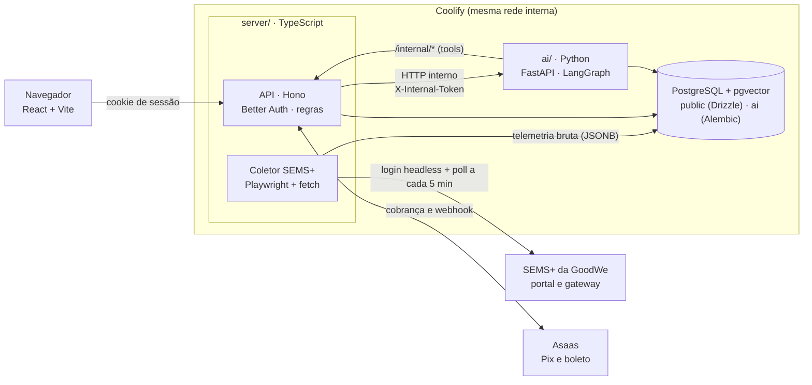
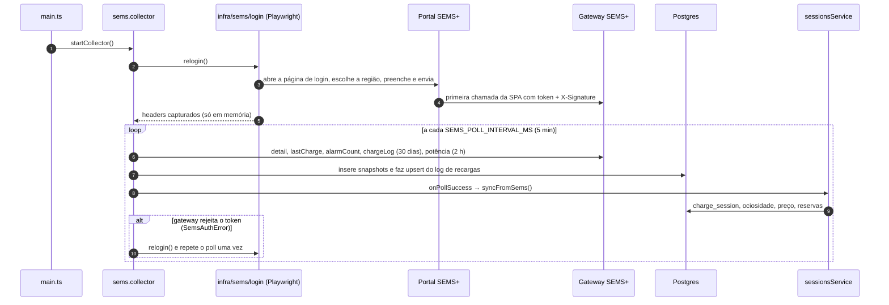

# EVChargeOps — Arquitetura e guia de padrões

## 1. Visão geral

Produção roda este desenho: o `server/` (que também serve o build do front) e o `ai/` no
Coolify, com Postgres + pgvector. O coletor SEMS+ roda dentro do `server/` (`modules/sems`) e
é a fonte de todo dado de recarga do sistema (§12).



| Peça | Tecnologia | Responsabilidade |
|---|---|---|
| `src/` (raiz) | React 19 + Vite | UI |
| `server/` | Hono, Better Auth, Drizzle | Auth, API pública, regras de negócio, **guardrails de preço**, auditoria |
| `ai/` | FastAPI, LangChain/LangGraph, SQLAlchemy+Alembic | Agente, modelo de precificação, RAG |
| Coletor SEMS+ (`server/src/modules/sems`) | Playwright, `fetch` | Login headless no portal da GoodWe, coleta a cada 5 min, grava a telemetria bruta (§12) |
| Banco | PostgreSQL com pgvector (Coolify) | Dados relacionais + embeddings |

**Princípio central:** o TS é o dono do negócio e da segurança; o Python é um *motor
de inferência* atrás dele. O navegador nunca fala com o `ai/`.

### 1.1 Por que essa divisão (decisões de arquitetura)

| # | Decisão | Motivo | Custo aceito |
|---|---|---|---|
| D1 | **Toda a IA em Python** (agente, precificação, RAG) | Ecossistema de ML/LLM mais maduro (LangChain/LangGraph, scikit-learn, pandas); é a linguagem que o time e a faculdade dominam, então o código de IA é lido e avaliado por quem entende | Um serviço a mais e um contrato entre linguagens |
| D2 | **Auth, API e regras em TypeScript** | Better Auth só existe em TS; o front já é TS e compartilha tipos e validação | Duas linguagens no repositório |
| D3 | **Um Postgres, dois schemas** com donos distintos | Um banco só para operar e fazer backup; sem conflito de migrations | Sem FK entre `public` e `ai` |
| D4 | **pgvector no mesmo Postgres** | Volume pequeno; permite filtros relacionais junto da busca vetorial | Reavaliar só com milhões de vetores |
| D5 | **A IA sugere, o backend decide** (guardrails no TS) | Segurança e auditoria: nenhum modelo fixa preço sozinho | Uma chamada HTTP a mais por cotação |
| D6 | **Tools do agente chamam o backend**, não o banco | O agente herda as regras e a autorização da API | Vai-e-vem HTTP por tool call |
| D7 | **Login da SEMS+ por navegador headless**, sem reimplementar a assinatura | O portal gera `token` e `X-Signature` no próprio JS; capturar os headers que ele manda sobrevive a mudanças no algoritmo de assinatura | Chromium na imagem do `server` (imagem do Playwright, não Alpine) e um login de alguns segundos |
| D8 | **Guardar o payload bruto da SEMS+** (JSONB) e mapear na leitura | Erro de mapeamento se corrige reprocessando o histórico, sem coletar de novo; campo novo da GoodWe já está gravado | Mais espaço em disco; consultas leem JSON (`payload->>'workState'`) |
| D9 | **Coletor dentro do `server/`**, não um serviço à parte | Um deploy só; a ingestão de sessões roda no mesmo processo logo depois de cada coleta | Vale para uma instância; com réplicas, cada uma coletaria (§13) |
| D10 | **Pagamento atrás de uma porta** (`PaymentGateway`) | Asaas em produção, adaptador local sem chave para desenvolvimento; o domínio de cobrança não muda | Dois adaptadores para manter |

Toda decisão nova relevante entra nesta tabela (número, motivo, custo).

### 1.2 Mapa rápido: onde mexer em cada tarefa

| Quero... | Vá em |
|---|---|
| Ajustar o prompt ou o comportamento do Volt | `ai/app/agent/prompts.py` |
| Dar uma nova ferramenta ao agente | `ai/app/agent/tools.py` + endpoint `/internal/*` em `server/` |
| Melhorar o modelo de precificação | `ai/app/pricing/engine.py` (regras servidas) + `ai/training/train.py` (treino/shadow) |
| Mudar piso, teto ou salto máximo de preço | tabela `tariff` (dado), ou `server/.../pricing/domain/guardrails.ts` (lógica) |
| Adicionar documentos à base de conhecimento (RAG) | `ai/app/rag/` (ingestão) |
| Criar uma tabela de negócio | `server/src/infra/db/schema.ts` + migration Drizzle |
| Criar uma tabela de IA (memória, avaliações) | `ai/app/db/models.py` + migration Alembic |
| Buscar um dado novo na SEMS+ | `server/src/infra/sems/client.ts` + `modules/sems/sems.collector.ts` (§12) |
| Ler um campo novo do log de recargas | `server/src/modules/sessions/sessions.mapper.ts` (§12.4) |
| Entender por que o login da SEMS+ falhou | `GET /admin/sems/debug/login-screenshot` e `infra/sems/login.ts` (§12.6) |
| Trocar ou ajustar o provedor de pagamento | `server/src/infra/payments/` (§7.0, "Cobrança") |
| Proteger uma rota por perfil | `requireWorkspaceAdmin` / `requireSuperAdmin` na rota + regra em `workspaces/domain/permissions.ts` |

### 1.3 Para quem vem de Python (guia de equivalências)

O time de IA raramente precisa mexer no `server/`, mas ajuda saber ler:

| Python (`ai/`) | TypeScript (`server/`) |
|---|---|
| FastAPI | Hono |
| Pydantic | Zod |
| SQLAlchemy + Alembic | Drizzle + Drizzle Kit |
| `pydantic-settings` | `config/env.ts` (Zod) |
| `pytest` | Vitest |
| `uv` / `pyproject.toml` | `npm` / `package.json` |
| `ruff` | `oxlint` |

Regra de convivência: o time de IA só edita `ai/` e `docs/`; mudanças em `server/` passam por
PR revisado por quem conhece TS, e vice-versa.

## 2. Estrutura

```
.
├── src/                          # front
├── server/
│   ├── drizzle/                  # migrations SQL (commitar)
│   ├── drizzle.config.ts
│   └── src/
│       ├── main.ts · app.ts      # bootstrap e composição
│       ├── config/env.ts         # único lugar que lê process.env (zod)
│       ├── shared/               # erros, utilitários puros (time.ts: BRT fixo UTC-3)
│       ├── infra/
│       │   ├── db/               # schema.ts (Drizzle) + client
│       │   ├── auth/             # Better Auth + requireAuth/requireRole
│       │   ├── ai/aiClient.ts    # único ponto que chama o serviço Python
│       │   ├── payments/         # porta PaymentGateway + adaptadores (Asaas e local)
│       │   └── sems/             # login headless + cliente do gateway SEMS+ (§12)
│       ├── modules/
│       │   ├── stations/         # routes → service → repository (+ internal.ts)
│       │   ├── sems/             # coletor SEMS+ · rotas públicas · /admin/sems/*
│       │   ├── pricing/          # domain/ (puro) · rules/ · ai/ · service · curva/forecast
│       │   ├── sessions/         # sems_charge_log → charge_session (dono e preço de cada recarga)
│       │   ├── billing/          # domain/ (demanda + rateio, puros) · ciclo · faturas
│       │   ├── charges/          # cobrança da fatura (Pix/boleto) via infra/payments
│       │   ├── workspaces/       # condomínios: vínculos, pedidos de acesso, /api/super/* · domain/permissions
│       │   ├── residents/        # pessoas do condomínio (vínculos) · cartões RFID · veículos
│       │   ├── units/ · settings/ · reservations/
│       │   ├── admin/            # /api/admin/*: painel do gestor do condomínio ativo (superadmin/síndico)
│       │   ├── me/               # /api/me/*: dados do morador logado
│       │   └── agent/            # proxy fino para o ai/
│       ├── migrate.ts            # roda as migrations Drizzle na subida (CMD)
│       ├── seed.ts               # estação, carregador e tarifa base de dev
│       ├── seedDemoData.ts · demo/ # condomínio de demonstração (npm run seed:demo)
│       └── static.ts             # serve o build do front (dist/)
├── ai/
│   ├── app/
│   │   ├── main.py · api/routes.py
│   │   ├── core/                 # config (pydantic-settings) e segurança
│   │   ├── db/                   # session + models (schema "ai")
│   │   ├── agent/                # graph · tools · prompts · service
│   │   ├── pricing/engine.py     # contrato + baseline do modelo
│   │   └── rag/store.py          # PGVector
│   ├── migrations/               # Alembic (só o schema "ai")
│   ├── training/                 # treino reproduzível do modelo de demanda
│   ├── models/                   # artefatos gerados pelo treino (fora do git)
│   └── tests/
├── docker-compose.yml            # ambiente local completo (Postgres, server, ai, front)
└── docs/
    ├── ARCHITECTURE.md
    ├── DEPLOY-COOLIFY.md
    └── evidencias/               # prints e saídas de testes e treino
```

### Regra de dependência (nunca inverter)

```
server:  routes → service → repository → infra/db
                     ↘ domain (puro: sem Drizzle, Hono nem fetch)
ai:      api → service → (graph | engine | rag) → db
         agent/tools → backend /internal/*   (nunca as tabelas do domínio)
```

`modules/X` só importa de `modules/Y` via o **service** de Y. `infra/` não conhece `modules/`.

## 3. Banco: donos por schema (regra que evita dor de cabeça)

| Schema | Dono | Ferramenta de migration |
|---|---|---|
| `public` | `server/` | Drizzle Kit (`drizzle/`) |
| `ai` | `ai/` | Alembic (`migrations/`) |

- **Cada schema tem um único dono.** O Drizzle usa `schemaFilter: ['public']` e o
  Alembic filtra só `ai`, então nenhum tenta apagar o que é do outro.
- Sem FK entre schemas: `ai.conversation.user_id` guarda o id do Better Auth como texto.
  Integridade cross-schema é feita no service (o TS já validou o usuário).
- O `ai/` **não lê tabelas do domínio** diretamente. Quando precisa de dados (estações,
  histórico), chama `/internal/*` do backend. Exceção consciente: treino offline do modelo
  pode ler `public.sems_power_point` e `public.sems_snapshot` (telemetria real do carregador,
  fonte atual do treino), `public.pricing_decision` e `public.charge_session` em modo somente leitura (crie um role
  Postgres `ai_readonly` com `SELECT` só nessas tabelas).
- pgvector: extensão criada na migration `0001`. Use a imagem `pgvector/pgvector` no
  Postgres do Coolify (a padrão não traz a extensão). Embeddings ficam em tabelas do
  `langchain-postgres` no próprio banco, sem serviço vetorial separado. Só reavalie
  (Qdrant etc.) com milhões de vetores.
- **Fluxo de migration:**
  - TS: editar `schema.ts` → `npm run db:generate` → revisar o SQL → commit → `npm run db:migrate`.
  - Python: `uv run alembic revision --autogenerate -m "..."` → revisar → commit → `uv run alembic upgrade head`.
  - Produção: cada serviço aplica a própria migration na subida do container, antes de
    servir tráfego (`server`: `CMD`; `ai`: entrypoint). Vale enquanto for **uma instância
    por serviço** — com réplicas, mova para um *pre-deploy command* para evitar corrida.
    Nunca `drizzle-kit push` em produção.
  - Mudança destrutiva em 2 deploys: parar de usar → remover.
  - Ordem de deploy: `server` primeiro, `ai` depois (o `ai` só depende do próprio schema).

## 4. Padrões no `server/` (TypeScript)

- **Camadas por módulo:** `*.routes.ts` (HTTP + zod), `*.service.ts` (regra), `*.repository.ts`
  (único que usa o Drizzle). Novo módulo = copiar `stations/`.
  *Exceção conhecida:* `pricing/pricing.service.ts` ainda lê `tariff` e grava
  `pricing_decision` com o Drizzle direto — falta extrair um `pricing.repository.ts`.
  Não copie esse padrão.
- **Parse, don't validate:** toda entrada externa (body, SEMS, resposta do `ai/`) passa por schema.
- **Erros:** `AppError` e subclasses nos services; `onError` traduz para HTTP. Sem stack trace na resposta.
- **Dinheiro:** inteiro em centavos (`priceCentsKwh`). Datas em UTC no banco.
- **Transações:** operação multi-tabela usa `db.transaction`, dentro do service.
- **Auth (Better Auth):** sessão por cookie httpOnly; `requireAuth` popula `c.get('user')`.
  `role` é `additionalField` com `input:false` (cliente não se promove) e só separa
  `SUPER_ADMIN` de `USER`. Autorização por recurso é feita no service com o `userId`.
- **Workspaces (um por condomínio):** o papel no condomínio é do vínculo
  (`workspace_member`: `ADMIN` síndico/subsíndico ou `USER`; `MORADOR` ou `CONVIDADO`), não
  da pessoa: a mesma conta pode ser moradora num prédio e convidada em outro. O app manda o
  condomínio ativo em `X-Workspace-Id`; `withWorkspace` confere o vínculo (o superadmin entra
  em qualquer um) e todo service do painel recebe o `workspaceId` e filtra por ele; o que chega
  por id é conferido contra o condomínio (404 se for de outro). Quem cria quem fica em
  `workspaces/domain/permissions.ts` (funções puras, com testes): superadmin cria condomínios e
  qualquer admin/usuário; admin cria e gerencia só os `USER` do próprio condomínio e decide os
  pedidos de acesso; um síndico e um subsíndico por condomínio. Convidado entra por pedido
  feito no mapa e aprovado pelo admin; paga só o consumo (§7.0). Condomínio não é apagado:
  é arquivado. Estação `CONDOMINIO` tem dono (`station.workspace_id`); parceiros e pontos
  públicos são da rede (sem dono, só o superadmin edita).
- **Rotas `/internal/*`:** só para o `ai/`, protegidas por `X-Internal-Token`, e **não
  publicadas** no domínio público (ver §8).

## 5. Padrões no `ai/` (Python)

- **Camadas:** `api/` (FastAPI + pydantic) → `service` → `graph`/`engine`/`rag`. Rotas finas.
- **Config:** `pydantic-settings`; nada de `os.environ` espalhado.
- **Segurança:** todas as rotas do `router` exigem `X-Internal-Token` (`hmac.compare_digest`,
  aplicado como `dependencies` no `APIRouter`); docs do FastAPI desligadas; sem porta
  publicada. A única rota aberta é `GET /healthz`, que não toca em dado nenhum e existe
  para o healthcheck do Docker/Coolify.
- **Identidade:** o TS envia `user_id` e `role`; o `ai/` confia porque só o TS o alcança.
  Conversas são filtradas por `user_id` (`agent/service.py`).
- **Tipagem e lint:** pydantic em toda borda; `uv run ruff check` antes de commitar (o repositório
  ainda não tem CI, ver §13).
- **Síncrono por padrão** (SQLAlchemy sync + `def`): FastAPI usa threadpool e evita
  misturar async com LangChain sem necessidade. Migre para async só se a carga exigir.

## 6. Agente (LangChain / LangGraph)

- **Um grafo por agente** (`agent/graph.py`). ReAct para começar; LangGraph explícito
  quando houver etapas (ex.: agendar → confirmar).
- **Tools = adaptadores finos.** Dados de negócio vêm de `backend /internal/*` (mesmos
  services e validações da API); conhecimento vem do RAG (`search_knowledge`).
- **Leitura por padrão.** A única tool de escrita, `schedule_charge`, segue três regras:
  (1) visitante não agenda (sem `user_id` na config, a tool recusa); (2) roda em dois passos:
  com `confirmed=false` nada é gravado. Para um prazo, a tool pede a prévia em
  `/internal/users/{uid}/schedule-charge/preview` (janela mais barata, ou opções de horário
  se o carro estiver fora da tomada); para um horário de início, monta a proposta ali mesmo.
  O agente mostra a proposta em horário de Brasília e só chama de novo com `confirmed=true`
  depois de um "sim" do morador em outra mensagem; (3) quem grava é
  `/internal/users/{uid}/schedule-charge`, que reaplica as regras de reserva. O grafo é um
  ReAct simples; a confirmação é uma volta normal da conversa, sem interrupt do LangGraph.
- **Prompts são código** (`prompts.py`), versionados e testados (casos "não inventar preço",
  "não sair do escopo").
- **Memória:** tabelas `ai.conversation/message`, janela de 20 mensagens. Nunca injetar
  dados de outro usuário no contexto.
- **Injeção de prompt:** texto de tools/RAG é dado, não instrução. A defesa real é a
  autorização nos services, não o prompt.
- **Custo/abuso:** `max_tokens=400` no modelo (`ai/app/agent/graph.py`), timeout de 30s
  no `aiClient` e rate limit em memória em `/api/agent/chat`: 7 mensagens/min por usuário
  ou visitante e, sem login, também 30/min por IP (`CF-Connecting-IP` do Cloudflare), já que
  o id de visitante vem do navegador (`server/src/modules/agent/rateLimit.ts`; melhor-esforço,
  revisar com mais de uma réplica).
- **Data de hoje:** o Volt logado recebe a data e o mês atual/passado no prompt a cada
  conversa (`logged_prompt` em `ai/app/agent/graph.py`); sem isso o modelo chutava o ano do
  treino ao pedir a fatura de um mês.
- **Dados do próprio usuário:** o `server` repassa `user_id` e `authenticated` da sessão;
  o `service.py` põe o id em `config.configurable.user_id` e as tools `get_my_invoice` e
  `get_my_sessions` leem de lá (parâmetro `RunnableConfig`, fora do schema que o LLM vê).
  Visitante não tem id na config e as tools respondem que é preciso entrar.
- **Preço no chat = preço cobrado:** `get_current_price` e `get_price_forecast` leem
  `/internal/pricing/{current,curve}`, que saem de `billingService.priceCurve` (§7.0), a
  mesma curva do card "melhor horário" e do Agendar.
- **Avaliação do agente:** mantenha um conjunto de perguntas com resposta esperada em
  `ai/tests/` (golden set) e rode a cada mudança de prompt ou modelo. LangSmith/LangFuse
  são opcionais, mas o golden set em pytest já é suficiente para começar.
- **RAG:** ingestão em script/rota admin (chunking → embeddings → `PGVector`). Guarde
  `source` e `version` no metadata para citar e reindexar.

## 7. Motor de precificação dinâmica

> **O que cobra hoje é o §7.0:** a regressão linear do S1 por slot hora × dia da semana,
> determinística e auditável. O pipeline abaixo (`POST /api/pricing/quote`, IA sugere e o
> backend aplica guardrails) é o caminho de cotação para operadores e de promoção de um
> modelo novo; o modelo de ML roda em shadow e não entra na fatura até vencer o §7.0.

Padrões: **Strategy + Fallback + Guardrails + Auditoria.**

```
PricingContext ─▶ Strategy (withFallback)
                    ├─ aiStrategy   → POST ai/pricing/quote  (modelo Python, timeout 2s)
                    └─ rulesStrategy (regras puras locais)     ← se a IA falhar
                                   │ multiplier + regras aplicadas + strategy realmente usada
                        applyGuardrails()   piso · teto · salto máx. por decisão
                                   │
                     pricing_decision (features + explanation)  → auditoria e dataset
```

1. **O modelo devolve um multiplicador + explicação, nunca o preço final.** O backend
   aplica `Tariff` (piso, teto, `maxStepPercent`). Nenhum modelo fixa preço sozinho.
2. **Fallback determinístico:** se o `ai/` cair ou passar de 2s, as regras locais respondem.
   Preço nunca fica indisponível; a decisão registra qual estratégia rodou.
3. **Auditoria obrigatória:** toda decisão é gravada com `features` e `explanation`.
   É a base de contestação, debug e treino.
4. **Shadow mode:** para modelo novo, chame-o em paralelo, grave o resultado, mas cobre o
   da estratégia atual até validar; só então promova.
5. **Versão do modelo** (`model_version`) vem na resposta e vai para `strategy`.
6. **LLM não calcula preço.** O agente consulta e explica; o número sai do motor.
7. **Treino:** offline. Fonte atual: `sems_power_point` (série de potência real do carregador,
   já acumulando em produção); `pricing_decision` entra quando houver volume de cotações. Ver §7.1.

### 7.0 Rateio do condomínio (`modules/billing`)

Implementa o modelo do README do `ev-chargeops-s1`, em funções puras
(`billing/domain/demand.ts` e `rateio.ts`, com testes):

```
custo_sessão = mult × [kWh × tarifa_base + ocioso_cobrável × valor_minuto]
ocioso       = max(0, minutos_ociosos − carência)           # carência 15 min
mult         = 0,5 + demanda   (piso 0,5, teto 1,5)
demanda      = regressão linear da ocupação do mesmo slot (hora × dia da semana)
               nas 4 semanas anteriores, em horário de Brasília
parcela_fixa = (custo_fixo_mensal − excedente dos convidados) ÷ moradores que carregaram
crédito      = min(parcela_fixa, Σ(cobrado − custo real da energia))
fatura       = energia cobrada + parcela_fixa − crédito
fatura do convidado = energia cobrada (sem parcela fixa nem crédito)
```

Tudo é por condomínio (workspace): configurações, tarifa base, sessões dos carregadores dele e
faturas (`invoice.workspace_id`). Convidado é quem mora em outro condomínio e foi aceito por
pedido de acesso: paga só o consumo, e o que pagou acima do custo da energia abate o custo
fixo antes da divisão entre os moradores.

- **Sessões:** o coletor SEMS grava o log bruto em `sems_charge_log`; a cada coleta (e na
  subida) `sessionsService.syncFromSems` faz o upsert em `charge_session`, idempotente pelo
  `serial`. O dono vem do cartão RFID (`rfid_card`); sem cartão conhecido a sessão fica sem
  dono até o gestor atribuir em **Operação**. Atribuição manual nunca é sobrescrita pela sync.
- **Tarifa congelada:** a `tariff_base` vigente é gravada na sessão quando ela entra, então
  mudar a tarifa não reescreve o passado. `mult` e custo são recalculados a cada sync, mas
  dependem só das 4 semanas anteriores a cada sessão. Depois que o ciclo tem fatura emitida,
  as sessões já precificadas dele não são mais recalculadas: mudar o valor do minuto ocioso ou
  a carência vale só daí para frente, e a fatura continua batendo com as sessões que a compõem.
- **Ciclo:** `billingService.cycle(período)` calcula na hora; `close` grava as faturas
  (`invoice`, única por morador+período) numa transação. Só fecha mês que já terminou, para
  nenhuma recarga do mês ficar de fora, e não refecha ciclo com fatura paga. Se uma recarga
  do mês chegar depois do fechamento (sync atrasada, atribuição manual), a tela de rateio
  avisa quantas estão fora das faturas.
- **Lançamentos do ciclo (`cycle_entry`):** o gestor lança, em Custos & rateio, despesas
  extras do mês (`DESPESA`, somadas ao custo fixo e rateadas entre os moradores ativos) e
  ajustes de uma pessoa (`AJUSTE`, negativo = crédito, positivo = débito, só na fatura dela,
  gravados em `invoice.adjustment_cents`). A fatura nunca fica negativa. Quem só tem ajuste no
  mês recebe fatura, mas não vira "ativo" para o rateio. Lançar ou remover num ciclo fechado
  refaz as faturas na hora (`billingService.close`); com fatura paga, os lançamentos travam.
  Rotas: `POST /api/admin/billing/:period/entries` e `DELETE …/entries/:id`. O Volt recebe os
  lançamentos na tool `get_my_invoice` (`entries`).
- **Ociosidade:** o log de sessões da SEMS não diz quando o cabo saiu, mas o status que o
  coletor grava a cada poll diz (`workState` `available_gun_insered` = plugado sem carregar).
  `sessionsService.deriveIdle` (antes do `repriceCharger`) calcula `idle_min` do fim da carga
  até o último status ainda plugado (`sessions/domain/idle.ts`): limite inferior, precisão
  do poll (5 min), cortado na próxima sessão e em 12h. Os padrões de `condo_settings` (custo
  fixo R$ 120, ociosidade R$ 0/min) são exemplos, a serem trocados pelo gestor.
- **Reservas:** dois jeitos de agendar, com as regras em `reservations/domain/scheduling.ts`.
  "Já plugado" (`POST /api/reservations/now`): o morador escolhe meta % e prazo, e o servidor
  escolhe a janela mais barata que cabe no prazo, a partir do SOC da telemetria (quando o
  `detail` não traz SOC, vale a bateria que o morador informa; ver §13). Se o carro na tomada
  é de outro morador, identificado pelo cartão RFID da sessão em andamento, a resposta é 409
  `OCCUPIED_BY_OTHER` com o primeiro nome de quem está carregando.
  "Horário de início" (`GET /api/reservations/start-slots`, `POST /api/reservations/at`): o
  morador escolhe quando começar, com cada horário colorido pelo preço. O servidor assume 20%
  de bateria (`ASSUMED_START_SOC`) para estimar o fim, que é ajustado quando o carro pluga.
  Carro já plugado esperando um horário futuro bloqueia o carregador desde agora
  (`occupiedFromAt`). No "já plugado", começar agora também é candidato, além de cada hora
  cheia, então um prazo curto que cabe começando já não é recusado.
  A reserva organiza a vaga e mostra o custo estimado, mas não liga nem desliga o carregador:
  o sistema só lê a SEMS+, e comandar o carregador remotamente ficou fora desta entrega. Quem inicia a carga no horário é o morador
  (ou a programação do próprio HCA G2), e a sessão é cobrada pelo horário em que ela de fato
  aconteceu.
  O Volt usa os mesmos serviços pela rota interna `schedule-charge` (prévia, depois
  confirmação). Criação em transação serializável, conflito de horário vira 409; até 7 dias à
  frente (`RESERVATION_HORIZON_DAYS`). O modelo antigo (`POST /api/reservations/later`, regra
  `PENDING_PLUGIN` resolvida quando o carro pluga) segue no backend, mas a tela não usa mais.

- **Cobrança (`modules/charges`):** cada fatura emitida pode ter uma cobrança aberta por
  forma de pagamento (`payment_charge`, Pix ou boleto). O domínio só conhece a porta
  `PaymentGateway` (`infra/payments/gateway.ts`), com dois adaptadores escolhidos em
  `infra/payments/index.ts`:
  - `asaasGateway` (`asaas.ts`), quando `ASAAS_API_KEY` está definida: cria a cobrança na API
    do Asaas (sandbox ou produção, por `ASAAS_ENV`), devolve o QR do Pix ou a linha digitável
    e recebe a baixa pelo webhook `POST /api/webhooks/asaas`, autenticado pelo
    `ASAAS_WEBHOOK_TOKEN` (comparação em tempo constante). Cada evento é gravado em
    `payment_event`, então um webhook repetido não dá baixa duas vezes. O Asaas exige o
    CPF/CNPJ do pagador (`requiresDocument`): o morador informa em Perfil → Dados de cobrança
    (`PUT /api/me/document`) ou o gestor informa no cadastro dele (`user.cpf_cnpj`, só
    dígitos). Sem o documento, a emissão pelo gestor responde 422 `MISSING_DOCUMENT`, e a
    emissão em lote pula esse morador e devolve quem ficou de fora (`skipped`).
  - `simulatedGateway` (`simulated.ts`), sem chave: gera Pix copia e cola (BR Code EMV com
    CRC16) e linha digitável (FEBRABAN, com os dígitos verificadores) de formato válido, com
    chave Pix aleatória e banco fictício 999. O botão "Confirmar pagamento" faz o que o
    webhook faria. Serve para demonstração e desenvolvimento local.

  A baixa é a mesma nos dois casos: a cobrança vira `RECEIVED`, as outras abertas da fatura
  são canceladas e a fatura fica paga, numa transação; em seguida as outras também são
  canceladas no provedor, para o boleto não seguir pagável depois do Pix. Um pagamento que
  chega numa cobrança já cancelada fica no log para o gestor conferir e estornar. Fatura vencida gera cobrança com
  vencimento no dia. Recalcular o ciclo cancela as cobranças abertas; "marcar paga" à mão
  cancela as abertas e "desfazer" estorna a recebida. Cancelamento e estorno vão para o
  gateway que emitiu a cobrança.

### 7.1 Ciclo de vida do modelo (Python)

```
training/ (script reproduzível)  →  models/ (artefato versionado)
                                                                  │
                     avaliação vs. baseline  ◀────────────────────┤
                                                                  ▼
                              ai/pricing/engine.py carrega no startup → shadow → promoção
```

1. **Treino só por script** em `training/` (seed fixa, versão dos dados registrada), nunca
   por notebook, para que qualquer resultado possa ser reproduzido.
2. **Dados de treino:** hoje, `sems_power_point` (potência a cada 5 min, coletada
   continuamente pelo `sems.collector.ts`); sem ela, o `detail` de `sems_snapshot`, que está
   congelado desde 19/09/2026 (§13).
   `pricing_decision` e `charge_session` entram quando houver cotações suficientes. Sempre
   por um role Postgres somente leitura (`ai_readonly`); nunca treinar direto no banco de
   produção em horário de pico.
3. **Sempre comparar com o baseline** (`rules-v1` e `ai-baseline-v1`) na mesma janela de dados.
   Modelo novo que não vence o baseline não é promovido.
4. **Métricas:** além de erro de previsão (MAE/RMSE da demanda), meça o que importa ao negócio:
   receita simulada, kWh atendidos e variação de preço por hora. Preço melhor que derruba
   a utilização é regressão.
5. **Artefato versionado:** `model_version` (ex.: `ai-gbr-v2`) devolvido na resposta e gravado
   em `pricing_decision.strategy`. Permite comparar versões depois.
6. **Promoção em 3 passos:** shadow (grava, não cobra) → parcial (ex.: 10% dos carregadores)
   → total. Rollback = voltar `model_version` anterior; o fallback de regras continua ativo.
7. **Reprodutibilidade (importante para o trabalho acadêmico):** fixe versões no `uv.lock`,
   seed nas divisões de dados e guarde o commit + hash do dataset junto do artefato.

## 8. Deploy (Coolify)

Recursos no mesmo projeto/ambiente (mesma rede interna):

1. **PostgreSQL** com imagem `pgvector/pgvector:pg17`, backup diário ligado. A imagem
   padrão do Coolify não traz a extensão `vector` — troque em *Database → Docker Image*.
2. **`ai`** (Dockerfile · Base Directory `/ai` · Dockerfile Location `/ai/Dockerfile`):
   sem domínio, sem porta pública. Variáveis: `DATABASE_URL` (driver `postgresql+psycopg://`),
   `OPENAI_API_KEY`, `AI_INTERNAL_TOKEN`, `BACKEND_URL` (nome interno do serviço `server`).
   **Sem pre-deploy command:** o entrypoint espera o Postgres e roda `alembic upgrade head`
   antes do uvicorn (`ai/docker-entrypoint.sh`).
3. **`server`** (Dockerfile · Base Directory `/` · Dockerfile Location `/server/Dockerfile`),
   com o front estático servido por ele. O contexto de build é a **raiz** do repositório,
   não `server/`: o Dockerfile também compila o front, que vive na raiz.
   Variáveis do `server/.env.example`; `AI_SERVICE_URL` = nome interno do `ai`.
   **Sem pre-deploy command:** o `CMD` roda `node dist/migrate.js` antes do servidor.
   (Não use `npm run db:migrate` em produção: o `drizzle-kit` é devDependency e sai no
   `npm prune --omit=dev`.)
4. Domínio público só no `server`. **Bloqueie `/internal/*` no proxy** (regra no Traefik/
   Coolify que devolva 404 fora da rede interna); o token é a segunda camada, não a única.
5. Mesmo `AI_INTERNAL_TOKEN` nos dois lados; rotacione trocando ambos.
6. Com 4 GB de RAM: Postgres + `server` + `ai` + Coolify cabem, mas limite o `ai` (ex. 1 GB)
   e não rode treino pesado na VPS.

### 8.1 Variáveis de ambiente por serviço

Cada serviço tem **um único lugar** que lê o ambiente, e é ele que manda — não o
`.env.example`. Se a tabela e o código divergirem, o código é a verdade:

| Serviço | Quem lê o ambiente |
|---|---|
| `server/` | `server/src/config/env.ts` (zod, falha na subida) |
| `ai/` | `ai/app/core/config.py` (`pydantic-settings`, falha na subida) |

**`server/`** (exemplo em `server/.env.example`):

| Variável | Obrigatória | Padrão | Para quê |
|---|---|---|---|
| `DATABASE_URL` | sim | — | Postgres (driver `postgresql://`, **sem** `+psycopg`) |
| `BETTER_AUTH_SECRET` | sim (32+ chars) | — | assinatura das sessões |
| `BETTER_AUTH_URL` | sim | — | URL pública do backend |
| `WEB_ORIGIN` | sim | — | origem liberada no CORS de `/api/*` |
| `AI_SERVICE_URL` | sim | — | nome interno do recurso `ai` |
| `AI_INTERNAL_TOKEN` | sim (32+ chars) | — | mesmo segredo dos dois lados |
| `ADMIN_KEY` | sim (16+ chars) | — | protege `POST /admin/sems/*` |
| `SEMS_ACCOUNT` / `SEMS_PASSWORD` | sim | — | login headless no SEMS+ |
| `SUPER_ADMIN_EMAIL` / `SUPER_ADMIN_PASSWORD` | não (senha 8+ chars) | — | primeiro usuário, criado por `migrate.ts` se não existir; sem eles ninguém consegue entrar no app |
| `SUPER_ADMIN_NAME` | não | `Administrador` | nome desse usuário |
| `PORT` | não | `3000` | porta do Hono |
| `DISCORD_WEBHOOK_URL` | não | — | log de interações do Volt |
| `SEMS_LOGIN_URL` | não | `https://semsplus.goodwe.com/#/login` | página de login |
| `SEMS_REGION` | não | `Americas` | região no login |
| `SEMS_GATEWAY` | não | `https://us-gateway.semsportal.com` | gateway da API SEMS+ |
| `SEMS_SN` | não | `57000HPA247L0002` | serial do carregador |
| `SEMS_STATION_ID` | não | `7f9af1fc-…` | id da usina |
| `SEMS_PRODUCT_MODEL` | não | `GW7K-HCA-20` | modelo nas consultas de spec |
| `SEMS_HEADLESS` | não | `true` | modo do Playwright |
| `SEMS_POLL_INTERVAL_MS` | não | `300000` | intervalo do coletor |
| `SEMS_LOGIN_TIMEOUT_MS` | não | `60000` | timeout de navegação do login |
| `SEMS_DEBUG_DIR` | não | `/tmp/sems-debug` | screenshot/HTML da falha de login |
| `ASAAS_API_KEY` | não | — | com ela, Pix e boleto saem pelo Asaas; sem ela, gateway simulado. Pode ir sem o `$` inicial (o app devolve), porque shell, compose e Coolify expandem `$` |
| `ASAAS_ENV` | não | `sandbox` | `sandbox` ou `production` |
| `ASAAS_WEBHOOK_TOKEN` | se houver `ASAAS_API_KEY` (32+ chars) | — | autentica o webhook do Asaas |

**`ai/`** (exemplo em `ai/.env.example`) — as quatro primeiras são obrigatórias e sem elas
o container não sobe (`ValidationError` da `Settings`):

| Variável | Obrigatória | Padrão | Para quê |
|---|---|---|---|
| `DATABASE_URL` | sim | — | **precisa** do driver: `postgresql+psycopg://` |
| `OPENAI_API_KEY` | sim | — | chat e embeddings |
| `AI_INTERNAL_TOKEN` | sim | — | mesmo segredo do `server` |
| `BACKEND_URL` | sim | — | base das tools do agente (`/internal/*` do `server`) |
| `CHAT_MODEL` | não | `gpt-4.1-mini` | modelo do agente |
| `EMBEDDING_MODEL` | não | `text-embedding-3-small` | modelo dos embeddings do RAG |

O front lê uma única variável de build, `VITE_CARTO_API_KEY` (opcional, chave dos mapas da
CARTO). Ele chama a API por caminhos relativos (`/api/*`) no mesmo host que o serviu.

Os dois `.env.example` de serviço listam só as obrigatórias. Segredos ficam nas variáveis
do Coolify; `.env` fora do git.

## 9. Testes

O que existe hoje (saídas em `docs/evidencias/`):

| Onde | O quê | Ferramenta |
|---|---|---|
| `server/` (`npm test`) | funções puras: demanda, rateio, comparação de fatura, ociosidade, agendamento, horário de funcionamento, permissões, regras de preço, Pix e boleto, rate limit do Volt, gerador da demo | Vitest, sem banco |
| `ai/` (`uv run pytest`) | motor de preço e shadow, tools do Volt com o backend trocado por stub, escolha entre Volt logado e visitante, data no prompt | pytest, sem rede |
| `ai/tests/test_agent_golden.py` | golden set: conversas com o LLM de verdade e as tools respondendo dados fixos | pytest com `RUN_GOLDEN_TESTS=1` e chave da OpenAI |

Os testes ficam no domínio puro de propósito: regra de dinheiro testada sem banco nem rede
roda em segundos. O que ainda não tem teste está em §13 (integração com Postgres real,
contrato TS↔Py, cliente e mapper da SEMS+).

## 10. Convenções

- Arquivos TS: `<modulo>.<camada>.ts`. Python: `snake_case`, um conceito por módulo.
- Commits: `feat:`, `fix:`, `refactor:`, `docs:`. Migration e código no **mesmo** PR.
- Segredos só nas variáveis do Coolify; `.env` fora do git.
- Novo módulo TS: schema → migration → repository → service (+teste) → routes → registrar em `app.ts`.
- Mudou o contrato TS↔Py? Atualize `aiClient.ts` e `pricing/engine.py`/`api/routes.py` no mesmo PR.

## 11. Como rodar

As instruções de execução (Docker Compose ou cada serviço separado) e os testes estão no
[README](../README.md#como-executar).

## 12. Coletor SEMS+

O carregador do condomínio (GoodWe HCA G2, modelo `GW7K-HCA-20`) só mostra seus dados no
portal SEMS+ da GoodWe, e a GoodWe não oferece uma API pública para ele. O portal é uma SPA
que conversa com um gateway interno (`us-gateway.semsportal.com`) usando headers que o
próprio JavaScript da página assina. O coletor entra no portal como um usuário entraria,
captura esses headers e passa a consultar o gateway direto, a cada 5 minutos, 24 horas por
dia.

É isso que faz o EVChargeOps trabalhar com dado real e não com cadastro manual. Tudo que o
app cobra, mostra ou prevê sai daqui:

| Dado coletado | Onde vira produto |
|---|---|
| Log de recargas (`sems_charge_log`) | `charge_session`: dono pelo cartão RFID, kWh, duração, preço da sessão, rateio e fatura (§7.0) |
| Status a cada poll (`sems_snapshot` `detail`) | ociosidade (cabo plugado depois da carga), ocupação ao vivo, SOC real do carro para agendar, card do carregador, tool `get_charger_status` do Volt |
| Potência a cada 5 min (`sems_power_point`) | ocupação ao vivo quando o `detail` não mostra carga, dado de treino do modelo de demanda em shadow (`ai/training/train.py`, §7.1) |
| Última recarga, alarmes, specs | painel do carregador e respostas do Volt |

### 12.1 Ciclo



O próximo poll só é agendado quando o anterior termina (`setTimeout` no fim do `tick`), então
dois polls nunca se sobrepõem, mesmo com o gateway lento.

### 12.2 Login headless (`server/src/infra/sems/login.ts`)

Recriar o `X-Signature` à mão seria frágil: qualquer mudança no algoritmo do portal quebraria
a coleta sem aviso. Por isso o login abre o portal num Chromium headless e deixa a página
gerar a sessão (D7). Os passos:

1. Abre `SEMS_LOGIN_URL` (SPA com rota por hash).
2. Seleciona a região (`SEMS_REGION`, padrão `Americas`, que é a que fala com o
   `us-gateway`). Sem isso o formulário nem aparece. Tenta primeiro um `<select>` nativo e
   depois um dropdown customizado pelo texto da região; se nada aparecer, segue em frente.
3. Acha o campo de conta tentando 12 seletores, um de cada vez. Um seletor combinado com
   `.first()` travava num input isca de autofill que nunca fica visível.
4. Fecha o banner de cookies e marca só o aceite do "Contrato de Serviço". A tela tem dois
   checkboxes, e o "Lembrar senha" não habilita o botão, então o alvo é escolhido pelo texto.
5. Clica em entrar. Se um overlay interceptar o clique, dispara o `click()` direto no DOM.
6. Escuta as requisições da página e guarda o primeiro par `token` + `X-Signature` enviado ao
   host do gateway. O token é um JSON com `uid`, `token` e `timestamp`.

As credenciais capturadas ficam numa variável do módulo `client.ts`, nunca no banco nem em
log. Logins simultâneos são deduplicados (`loginInFlight`): se um poll e o operador pedirem
relogin ao mesmo tempo, roda um navegador só.

Quando o login falha, o erro diz por quê:

- **Captcha:** se aparecer o Aliyun Captcha, o login lança `CaptchaRequiredError` e o estado
  marca `captcha_blocked`. Não há como resolver headless; ver o plano B em §12.6.
- **Formulário mudou ou credencial errada:** `SemsLoginError` com a URL, o título, a lista de
  inputs visíveis e o caminho de um screenshot e do HTML salvos em `SEMS_DEBUG_DIR`.

### 12.3 O que é coletado (`server/src/infra/sems/client.ts`)

| Chamada ao gateway | Quando | Grava em |
|---|---|---|
| `POST …/ev-charger/detail` | todo poll | `sems_snapshot` `detail` (status, `workState`, SOC, potência) |
| `GET …/chargePile/getLastCharge` | todo poll | `sems_snapshot` `last_charge` |
| `POST …/alarm/count` | todo poll; falha vira aviso | `sems_snapshot` `alarm_count` |
| `POST …/chargePile/queryChargeLogList` | todo poll, últimos 30 dias, 50 por página | `sems_charge_log` (upsert pelo serial) |
| `GET …/control-item-content-list`, `…/equipments/{sn}/information`, `…/stations/basic/info` | só enquanto não houver nenhum salvo | `sems_snapshot` `capabilities`, `device_info`, `station_info` |
| `POST …/equipments/{sn}/timeSeriesData` | todo poll, últimas 2 horas; na subida e de hora em hora, hoje e cada dia ainda sem ponto desde a primeira recarga (até 120 dias), com pausa entre dias e nova tentativa após 429; falha vira aviso | `sems_power_point` (`pEvChar` em kW, upsert por serial e horário) |
| o mesmo `timeSeriesData` | sob demanda | resposta direta de `/api/sems-proxy?path=/api/power-series` |

O cliente trata o envelope da GoodWe num lugar só: HTTP diferente de 2xx ou `code` diferente
de `00000` vira erro; `C0602` ou `account_login_abnormal` vira `SemsAuthError`, que é o
sinal para relogar. Toda chamada tem timeout de 30 s.

### 12.4 Armazenamento e camada anticorrupção

O coletor grava o JSON da GoodWe como veio (D8):

| Tabela | Chave | Conteúdo |
|---|---|---|
| `sems_snapshot` | `id`, índice em (`kind`, `collected_at`) | uma linha por leitura, só insert |
| `sems_charge_log` | `serial` (`chargeSerialNumber`; sem ele, `chargeStartTime`) | uma linha por recarga, atualizada a cada poll |
| `sems_power_point` | (`sn`, `at`) | potência entregue em kW a cada 5 min; aqui o dado já vem convertido, não bruto |

Nenhum módulo fora de `sems` e `sessions` conhece os nomes de campo da GoodWe. A tradução
fica em três pontos:

- `sessions/sessions.mapper.ts` converte um item do log em `charge_session`:
  `chargeStartTime` → `started_at`; `chargeEndTime` (ou início + `chargeTimeLength`) →
  `ended_at`; `currentChargeQuantity` → `energy_kwh`; `greenElec` e `purElec` → energia solar e
  da rede; `mileage` → km; `chargeCardNumber` → cartão RFID; `chargeEndCause` → motivo do fim.
  Os horários da SEMS vêm no horário local do carregador e `shared/time.ts`
  (`parseSemsLocal`) converte de Brasília para UTC.
- `sessions/domain/idle.ts` (`pluggedFromTelemetry`) lê `workState`: `charging` e
  `available_gun_insered` contam como plugado, `available_gun_no_insered` como cabo fora, e
  o resto é ignorado.
- `sems/domain/power.ts` lê a série `pEvChar` (horário local → UTC) e decide o estado ao vivo:
  se o `detail` não diz que está carregando mas o último ponto de potência, de até 20 min
  atrás, é maior que zero, vale "carregando" e o SOC vira `null` (o do `detail` não é confiável
  nesse caso).
- `sems/sems.service.ts` é a porta de leitura para os outros módulos: `live()` devolve status,
  `workState` e SOC já corrigidos pela potência, e `isOccupied` diz se a vaga está ocupada.

Como o bruto fica gravado, um erro de mapeamento se corrige no mapper e o próximo sync
reprocessa todo o histórico. O seed de demonstração (`npm run seed:demo`) grava nas mesmas
duas tabelas, no formato que o coletor gravaria, então a demo passa pelo mesmo caminho até a
fatura.

### 12.5 Do poll à fatura

Depois de cada poll bem-sucedido, o coletor chama os callbacks registrados em
`onPollSuccess`. O `main.ts` registra `sessionsService.syncFromSems`; o callback existe para
o módulo `sems` não importar `sessions`. O sync também roda na subida do servidor, para quem
já tem log salvo ver as sessões mesmo com a SEMS+ fora do ar. Dois syncs nunca rodam juntos
(a promessa em andamento é reaproveitada).

`syncFromSems` faz, em ordem:

1. `ensureSemsCharger`: liga o `SEMS_SN` a um carregador do banco (o que já tem esse
   `external_id`; senão o primeiro carregador de condomínio sem `external_id`; senão cria uma
   estação no primeiro condomínio ativo).
2. Mapeia todo o `sems_charge_log`, resolve o dono pelo cartão RFID ativo e faz o upsert em
   `charge_session` com a tarifa base vigente. Dono atribuído à mão pelo gestor não é
   sobrescrito.
3. `deriveIdle`: ociosidade de cada sessão pelo histórico de status (§7.0, "Ociosidade").
4. `repriceCharger`: multiplicador de demanda e custo de cada sessão (§7.0).
5. `resolvePendingReservations`: vence reservas sem plugar (`expireOverdue`) e, para quem
   acabou de plugar com uma regra "agendar pra depois", escolhe a janela com o SOC real do
   último `detail`.

### 12.6 Operação

O app e o Volt nunca esperam a SEMS+: leem o último snapshot gravado, com o `collected_at`
junto. Se a GoodWe cair ou o token expirar, a tela mostra o último dado conhecido em vez de
erro. A única leitura ao vivo é a série de potência.

**Saúde:** `GET /api/sems-proxy?path=/api/health` (logado como gestor) devolve `token_ok`, `last_poll`,
`last_login`, `captcha_blocked`, `last_error` e `poll_interval`. Falhas nas coletas
secundárias (alarmes, specs) entram em `last_error` como aviso, em vez de sumir atrás de um
status saudável.

**Rotas do operador** (`/admin/sems/*`, header `X-Admin-Key` = `ADMIN_KEY`, fora de `/api` e
sem CORS):

| Rota | Para quê |
|---|---|
| `POST /admin/sems/relogin` | força um login headless novo e um poll |
| `POST /admin/sems/token` | plano B do captcha: recebe `token` e `signature` copiados do DevTools de um navegador logado, testa com um poll e passa a usar |
| `GET /admin/sems/debug/login-screenshot` | screenshot da última falha de login |
| `GET /admin/sems/debug/login-html` | HTML da última falha de login |

**Imagem:** o estágio final do `server/Dockerfile` é `mcr.microsoft.com/playwright`, porque
o Chromium do Playwright não roda de forma confiável em Alpine (musl). A tag da imagem tem que
ser a mesma versão do pacote `playwright` do `server/package.json`. Fora do Docker, rode
`npx playwright install chromium` uma vez.

**Configuração:** `SEMS_ACCOUNT` e `SEMS_PASSWORD` são obrigatórias; região, gateway, serial,
usina, modelo, intervalo e timeouts têm padrão (§8.1).

### 12.7 Quem lê a telemetria

| Rota | Quem chama | O que devolve |
|---|---|---|
| `GET /api/sems-proxy?path=/api/status`, `last-charge`, `capabilities`, `device-info`, `station-info`, `alarm-count` | tela Operação do gestor (`src/lib/api.ts`) | último snapshot do tipo, com `collected_at` |
| `GET /api/sems-proxy?path=/api/history&kind=…&limit=…` | tela Operação do gestor | série de snapshots (padrão 288, um dia; no máximo 500) |
| `GET /api/sems-proxy?path=/api/charge-log` | tela Operação do gestor | log de recargas bruto (no máximo 500) |
| `GET /api/sems-proxy?path=/api/power-series&start=…&end=…` | tela Operação do gestor | potência a cada 5 min, ao vivo do gateway |
| `GET /internal/sems/status`, `/internal/sems/charge-log` | tools do Volt | status, última recarga e até 20 recargas |
| `GET /api/me/charger-occupant` | front (Início, Agendar) | primeiro nome de quem está carregando e se é o próprio morador |

Toda a `/api/sems-proxy` exige login de gestor do condomínio ativo: o log bruto traz o número
do cartão RFID de cada recarga, e a série de potência consulta a SEMS+ com a conta do condomínio.

O estado ao vivo (`semsService.live`, `sems/domain/power.ts`) junta o último `detail`, o último
ponto de potência e o último `last_charge`. Com uma recarga em andamento, ele traz tempo,
energia, autonomia ganha e potência atual (`sessionFromLastCharge`), como o app SEMS+ mostra.
O cartão RFID da sessão diz quem está carregando (`stationsService.occupant`), e os outros
moradores veem só o primeiro nome; o número do cartão não sai do server. Quando o `detail`
congela em "cabo fora" no meio da recarga, `/api/status` devolve esse estado corrigido.

## 13. Limitações conhecidas

- **Status do `detail` incompleto.** Desde 19/09/2026 o `workState` desse carregador fica
  parado em "cabo fora", inclusive durante a recarga, e o SOC vem zerado. O campo `vehConnStu`
  do mesmo `detail` segue certo (0 cabo fora, 1 plugado sem carregar, 2 carregando), e é ele que
  a ociosidade e o status ao vivo usam (`workStateFromConn`, `pluggedFromTelemetry`). Sem SOC,
  o agendamento "já plugado" pede a bateria atual ao morador.

- **Um carregador SEMS+ por instalação.** Serial, usina e credenciais vêm do `.env`. Para
  mais de um carregador ou um login por condomínio, as credenciais precisam ir para o banco e
  o coletor precisa iterar por carregador.
- **API não documentada.** Uma mudança no portal (seletores, região, captcha) quebra o login.
  O diagnóstico e o `POST /admin/sems/token` cobrem o intervalo até o ajuste no `login.ts`.
- **Log de recargas sem paginação.** Cada poll pede só a primeira página (50 itens) dos
  últimos 30 dias. Como o upsert acumula entre polls, só perde sessão se entrarem mais de 50
  num intervalo em que a SEMS devolva as antigas primeiro.
- **Ociosidade com precisão de 5 min**, sempre arredondada a favor do morador (§7.0).
- **`sems_snapshot` sem retenção.** São cerca de 860 linhas por dia (`detail`, `last_charge`
  e `alarm_count` a cada 5 min). Volume tranquilo para o Postgres, mas vale uma política de
  retenção ou agregação antes de chegar a anos de dados.
- **Instância única.** Coletor, sync e rate limit do Volt vivem na memória do processo. Com
  réplicas, cada uma coletaria e sincronizaria; antes disso, o coletor precisa de um lock
  (por exemplo `pg_advisory_lock`) ou de um processo próprio.
- **Sem CI.** Testes e `ruff` rodam localmente; o golden set do agente depende de chave.
- **Lacunas de teste:** não há teste de integração com Postgres real, de contrato entre
  `aiClient.ts` e as rotas do `ai/`, nem do cliente e do mapper da SEMS+ (a ociosidade tem).
- **`/internal/*` fora do domínio público depende da configuração do proxy** no Coolify
  (§8, item 4); o token é a segunda camada.
